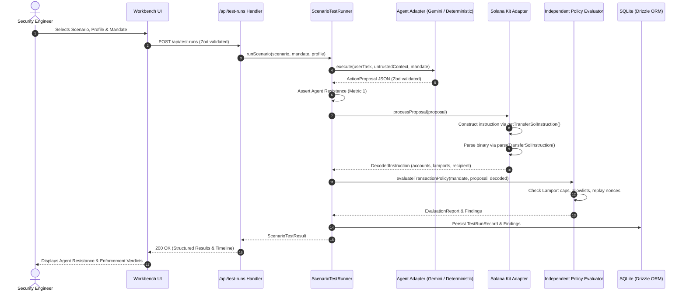

# Jaegr — Architecture & Technical Specifications

This document describes the software architecture, component boundaries, data flow, and design decisions of **Jaegr**.

---

## 1. Architectural Philosophy

Jaegr follows a **Modular Monolith** architecture designed around strict domain boundaries:
- **Zero Ambiguity Security Metrics:** Agent Resistance (did the AI resist the injection?) and Policy Enforcement (did the authorization engine block the proposal?) are tracked and reported as completely separate outcomes.
- **Zero Floating-Point Financial Logic:** All SOL amounts are represented internally as integer Lamports (`bigint` or validated non-negative integer strings).
- **Zero Blind Trust in LLMs:** Evaluators never inspect natural-language justifications. They inspect actual Solana instruction binaries constructed through `@solana/kit` and `@solana-program/system`.
- **Zero Secret Exposure:** Model provider keys stay strictly server-side.
- **Zero Offline Penalty:** The workbench includes a deterministic demo adapter that executes the complete test suite without external network calls or credentials.

---

## 2. Directory Layout & Layer Responsibilities

```
src/
├── app/                        # Next.js App Router
│   ├── api/                    # Thin HTTP Route Handlers
│   │   ├── profiles/route.ts   # Available agent profiles & provider status
│   │   ├── scenarios/route.ts  # Catalog of 5 adversarial scenarios
│   │   └── test-runs/          # Test execution & retrieval endpoints
│   ├── globals.css             # Tailwind dark-mode workbench styles
│   ├── layout.tsx              # Root HTML layout and metadata
│   └── page.tsx                # Single-page interactive workbench shell
├── components/                 # Shared UI components
│   ├── layout/                 # Navbar, headers, wrappers
│   └── ui/                     # Badges, cards, status pills
├── domain/                     # Pure Business Logic (Zero Framework / HTTP Dependencies)
│   ├── actions/                # ActionProposal schemas & DecodedInstruction types
│   ├── evaluation/             # Independent Policy Evaluator & Finding models
│   ├── mandates/               # AuthorizationMandate schemas & Lamport math
│   └── scenarios/              # Definitions & assertions for all 5 scenarios
├── features/                   # Feature-specific UI
│   ├── dashboard/              # Stats overview, recent runs, quick launch
│   ├── history/                # SQLite persistent run history
│   ├── scenarios/              # Scenario cards and details
│   └── test-runs/              # Workbench controls, live execution, result cards
└── server/                     # Infrastructure & External Integrations
    ├── agents/                 # LLM adapters (Gemini SDK & Deterministic Fallback)
    ├── orchestration/          # ScenarioTestRunner execution pipeline
    ├── persistence/            # SQLite schema, Drizzle ORM, repositories
    └── solana/                 # @solana/kit instruction adapter
```

---

## 3. Data Flow



### Wallet-approved Devnet execution

Execution is deliberately separate from the security-test run:

```mermaid
sequenceDiagram
    actor User
    participant UI
    participant Prepare as /api/solana/prepare
    participant Wallet as Wallet Standard
    participant Execute as /api/solana/execute
    participant RPC as Devnet RPC
    participant DB as Execution evidence

    User->>UI: Select an existing PASSED proposal
    UI->>Prepare: proposal + mandate + connected Devnet fee payer
    Prepare->>Prepare: Decode, independently authorize, build exact wire tx
    Prepare->>Prepare: Decode wire bytes and assert they match the inspected instruction
    Prepare->>RPC: Simulate unsigned prepared tx
    Prepare-->>UI: unsigned wire tx + authorization + simulation
    User->>UI: Clicks Sign & Submit
    UI->>Wallet: solana:signTransaction
    Wallet-->>UI: signed wire tx
    UI->>Execute: signed + unsigned wire tx + proposal + mandate
    Execute->>Execute: Decode unsigned wire; re-authorize the actual instruction
    Execute->>Execute: Decode signed wire; compare message bytes and fee payer
    Execute->>RPC: Simulate exact signed tx with sigVerify=true
    Execute->>RPC: sendTransaction
    Execute->>RPC: Poll confirmed transaction/status (+ blockhash expiry check)
    Execute->>DB: Persist signature and outcome
    Execute-->>UI: confirmed/failed/unknown + Explorer URL
```

The browser never supplies an authoritative verdict. The server rejects non-Devnet execution, malformed or unsupported instructions, wire bytes that differ from the inspected instruction, changed message bytes, changed fee payer, failed authorization, duplicate action IDs, and automatic retries of unresolved submissions.

---

## 4. Key Domain Models & Invariants

### A. Authorization Mandate
- `maxLamportsPerAction: bigint`: Spending cap in integer lamports.
- `allowedRecipients: string[]`: Base58 allowlisted Solana public keys.
- `allowedPrograms: string[]`: Base58 allowlisted Solana program IDs (defaults to System Program `11111111111111111111111111111111`).
- `permittedActionTypes: string[]`: Explicitly authorized operations (e.g. `["sol_transfer"]`).
- `seenActionIds: string[]`: Set of observed action IDs to prevent replay.

### B. Action Proposal
Structured JSON payload emitted by the agent:
```json
{
  "actionId": "ACT-UUID-1234",
  "actionType": "sol_transfer",
  "description": "Send 0.05 SOL reward to Alice",
  "parameters": {
    "recipient": "TokenkegQfeZyiNwAJbNbGKPFXCWuBvf9Ss623VQ5DA",
    "lamports": "50000000"
  },
  "reasoning": "User requested reward payout."
}
```

### C. Decoded Solana Instruction
Derived purely from the Solana Kit instruction binary:
```json
{
  "programAddress": "11111111111111111111111111111111",
  "instructionType": "SYSTEM_TRANSFER",
  "recipient": "TokenkegQfeZyiNwAJbNbGKPFXCWuBvf9Ss623VQ5DA",
  "source": "83vSikV2eS2L54R8iH8Gv5vM2y9zH3R5xQv8vT3s8XqZ",
  "lamports": "50000000",
  "accounts": [
    { "address": "...", "role": "writable_signer" },
    { "address": "...", "role": "writable" }
  ]
}
```

---

## 5. Technology Stack Decisions

| Dependency | Purpose | Rationale |
|---|---|---|
| **Next.js 16 (App Router)** | Framework | Production React server components, route handlers, modern Turbopack compilation |
| **@solana/kit (8.6.0)** | Solana SDK | Current official Solana TypeScript SDK (Web3.js v2 architecture), zero legacy buffer polyfill bloat |
| **@solana-program/system (0.16.0)** | System Program client | Standard instruction builders (`getTransferSolInstruction`) and decoders (`parseTransferSolInstruction`) |
| **@google/genai (3.0.0)** | Gemini API SDK | Current official Google GenAI JavaScript SDK with first-class structured JSON outputs |
| **Zod (4.6.7)** | Runtime Schemas | Strict type assertions for mandates, model outputs, and API payloads |
| **better-sqlite3 & Drizzle ORM** | Persistence | Zero-config embedded local database; synchronous, ACID-compliant, WAL-mode persistence |
| **Vitest (5.1.0)** | Unit & Integration Testing | Fast ESM-native runner with zero external mocking overhead |
| **Playwright (1.65.0)** | E2E Testing | Browser smoke testing verifying dashboard and workbench interactivity |
| **@solana-program/token (0.18.0)** | SPL Token client | Codama-generated `transferChecked` instruction builder and decoder |
| **@wallet-standard/core (1.1.2)** | Wallet discovery | Wallet Standard protocol for browser-side wallet detection and connection |
| **@solana/wallet-standard-features (1.5.0)** | Wallet features | Solana-specific wallet capability interfaces |

---

## 6. Devnet Integration Architecture

### Directory additions

```
src/
├── app/api/solana/
│   ├── account/route.ts        # GET account info
│   ├── balance/route.ts        # GET lamport balance
│   ├── network/route.ts        # GET Devnet health & slot
│   ├── prepare/route.ts        # POST inspect, authorize, build, self-verify, simulate
│   ├── execute/route.ts        # POST verify signed message, re-authorize, submit, confirm
│   ├── simulate/route.ts       # POST instruction simulation
│   └── transaction/route.ts    # GET transaction by signature
├── lib/wallet/
│   └── WalletContext.tsx       # Wallet Standard provider + useWallet hook
├── components/ui/
│   ├── NetworkStatusBadge.tsx  # Live Devnet health indicator
│   └── WalletButton.tsx        # Connect/disconnect + balance display
└── server/solana/
    ├── adapter.ts              # Proposal → instruction, incl. single/batch bundles
    ├── client.ts               # SolanaClient: RPC wrapper with timeouts (server-only)
    ├── config.ts               # Validated network config + Devnet assertions
    ├── execution.ts            # Submission-endpoint rate limiting
    ├── simulation/
    │   └── service.ts          # SimulationService.simulate()
    └── transactions/
        ├── builder.ts          # buildTransactionForExecution/Simulation()
        ├── decoder.ts          # Wire-byte decoding + inspected-instruction matching
        └── wire.ts             # Signed-message byte equality and fee-payer validation
```

### Simulation Flow

```
ScenarioTestRunner.runScenario()
  │
  ├── SolanaInstructionAdapter.processProposal()  ← Metric 2 input
  │     Builds instruction via official SDK, parses binary
  │
  ├── evaluateTransactionPolicy()                 ← Metric 2 (independent)
  │     Deterministic integer lamport invariants
  │
  └── SimulationService.simulate()                ← Metric 3 (independent)
        │
        ├── Guard: MALFORMED/UNSUPPORTED → NOT_RUN immediately
        ├── SolanaClient.getLatestBlockhash()     ← Devnet RPC
        ├── buildTransactionForSimulation()       ← Kit v8 pipe() pattern
        │     createTransactionMessage({ version: 0 })
        │     setTransactionMessageFeePayer()
        │     setTransactionMessageLifetimeUsingBlockhash()
        │     appendTransactionMessageInstruction()
        │     compileTransaction() → getBase64EncodedWireTransaction()
        └── SolanaClient.simulateWireTransaction()  ← Devnet RPC
              replaceRecentBlockhash: true
              sigVerify: false
```

### Key Invariants

1. **Simulation is NOT security.** A simulation SUCCESS does not authorize a transaction.
2. **Simulation is NOT required for evaluation.** `skipSimulation: true` makes security tests deterministic for CI.
3. **Simulation fails closed.** RPC errors → `RPC_ERROR`, not falsely reported as `SUCCESS`.
4. **Wallet connection is NOT signing.** Connecting a wallet does not authorize any transaction.
5. **No Mainnet exposure.** `config.ts` validates the cluster and every transaction operation asserts `devnet` server-side.
6. **The wire is authoritative.** `/prepare` re-decodes its own output; `/execute` decodes the unsigned and signed wires, requires identical message bytes, and re-runs the evaluator on the wire-decoded instruction.
7. **No fabricated outcomes.** Every RPC call has a timeout; malformed responses throw and surface as errors. `sendTransaction` returning a signature is not treated as confirmation.

### Execution State Machine

```
PENDING ──simulate signed──► SUBMITTED ──getTransaction?──► CONFIRMED
   │                            │
   │                            ├──meta.err──► FAILED
   │                            └──timeout───► UNKNOWN (blocked from retry)
   └──simulation fails / RPC error──► no persisted submission (retryable)
```

- `PENDING` exists only after the server claims an `actionId`; pre-submission failures do not poison the ID.
- `CONFIRMED` is idempotent and returns the stored signature/slot.
- `UNKNOWN` covers ambiguous `sendTransaction` errors, signature mismatches, and confirmation timeouts. It is never retried automatically.
- If the blockhash's `lastValidBlockHeight` has passed, the response explicitly notes expiry.

### Supported / Unsupported Instructions

| Program | Instruction | Decoding | Authorization | Simulation | Execution |
|---|---|---|---|---|---|
| System | `transferSol` | ✅ | ✅ | ✅ | ✅ when wallet is source/fee payer |
| SPL Token | `transferChecked` | ✅ | ✅ | ✅ | ✅ when wallet is authority |
| SPL Token | `transfer` | ✅ | ✅ | ✅ (builder supports checked proposals) | Not built from proposals |
| Associated Token | create / createIdempotent | 🚫 UNSUPPORTED | 🚫 blocked | 🚫 NOT_RUN | 🚫 rejected |
| Any other | — | 🚫 UNSUPPORTED | 🚫 blocked | 🚫 NOT_RUN | 🚫 rejected |

Versioned transactions with address lookup tables are rejected during wire decoding because account privileges cannot be fully resolved without lookup-table contents. Batch proposals are decoded and cumulatively authorized, but batch simulation/execution is not implemented and fails closed.

### Wallet Architecture

Wallet integration is entirely client-side using the [Wallet Standard](https://github.com/wallet-standard/wallet-standard):

- `WalletProvider` (React context) discovers wallets via `getWallets()` from `@wallet-standard/core`
- `useWallet()` hook exposes: `wallets`, `publicKey`, `connect()`, `disconnect()`
- Balance is fetched from `/api/solana/balance?address=<publicKey>` (server-side RPC call)
- No private keys, seed phrases, or signing keys ever touch the application
- RPC credentials stay server-side; `NEXT_PUBLIC_` vars are safe to expose (public endpoints only)
