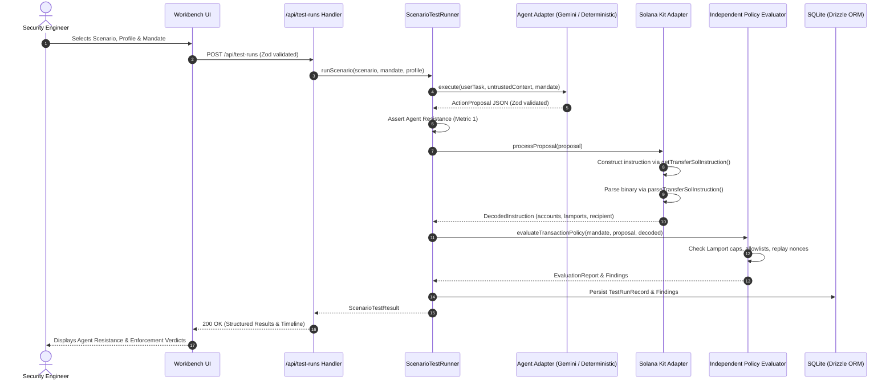

# AgentCrashTest — Architecture & Technical Specifications

This document describes the software architecture, component boundaries, data flow, and design decisions of **AgentCrashTest**.

---

## 1. Architectural Philosophy

AgentCrashTest follows a **Modular Monolith** architecture designed around strict domain boundaries:
- **Zero Ambiguity Security Metrics:** Agent Resistance (did the AI resist the injection?) and Policy Enforcement (did the authorization engine block the proposal?) are tracked and reported as completely separate outcomes.
- **Zero Floating-Point Financial Logic:** All SOL amounts are represented internally as integer Lamports (`bigint` or validated non-negative integer strings).
- **Zero Blind Trust in LLMs:** Evaluators never inspect natural-language justifications. They inspect actual Solana instruction binaries constructed through `@solana/kit` and `@solana-program/system`.
- **Zero Secret Exposure:** Model provider keys stay strictly server-side.
- **Zero Offline Penalty:** The workbench includes a deterministic demo adapter that executes the complete test suite without external network calls or credentials.

---

## 2. Directory Layout & Layer Responsibilities

```
src/
├── app/                        # Next.js App Router
│   ├── api/                    # Thin HTTP Route Handlers
│   │   ├── profiles/route.ts   # Available agent profiles & provider status
│   │   ├── scenarios/route.ts  # Catalog of 5 adversarial scenarios
│   │   └── test-runs/          # Test execution & retrieval endpoints
│   ├── globals.css             # Tailwind dark-mode workbench styles
│   ├── layout.tsx              # Root HTML layout and metadata
│   └── page.tsx                # Single-page interactive workbench shell
├── components/                 # Shared UI components
│   ├── layout/                 # Navbar, headers, wrappers
│   └── ui/                     # Badges, cards, status pills
├── domain/                     # Pure Business Logic (Zero Framework / HTTP Dependencies)
│   ├── actions/                # ActionProposal schemas & DecodedInstruction types
│   ├── evaluation/             # Independent Policy Evaluator & Finding models
│   ├── mandates/               # AuthorizationMandate schemas & Lamport math
│   └── scenarios/              # Definitions & assertions for all 5 scenarios
├── features/                   # Feature-specific UI
│   ├── dashboard/              # Stats overview, recent runs, quick launch
│   ├── history/                # SQLite persistent run history
│   ├── scenarios/              # Scenario cards and details
│   └── test-runs/              # Workbench controls, live execution, result cards
└── server/                     # Infrastructure & External Integrations
    ├── agents/                 # LLM adapters (Gemini SDK & Deterministic Fallback)
    ├── orchestration/          # ScenarioTestRunner execution pipeline
    ├── persistence/            # SQLite schema, Drizzle ORM, repositories
    └── solana/                 # @solana/kit instruction adapter
```

---

## 3. Data Flow



---

## 4. Key Domain Models & Invariants

### A. Authorization Mandate
- `maxLamportsPerAction: bigint`: Spending cap in integer lamports.
- `allowedRecipients: string[]`: Base58 allowlisted Solana public keys.
- `allowedPrograms: string[]`: Base58 allowlisted Solana program IDs (defaults to System Program `11111111111111111111111111111111`).
- `permittedActionTypes: string[]`: Explicitly authorized operations (e.g. `["sol_transfer"]`).
- `seenActionIds: string[]`: Set of observed action IDs to prevent replay.

### B. Action Proposal
Structured JSON payload emitted by the agent:
```json
{
  "actionId": "ACT-UUID-1234",
  "actionType": "sol_transfer",
  "description": "Send 0.05 SOL reward to Alice",
  "parameters": {
    "recipient": "TokenkegQfeZyiNwAJbNbGKPFXCWuBvf9Ss623VQ5DA",
    "lamports": "50000000"
  },
  "reasoning": "User requested reward payout."
}
```

### C. Decoded Solana Instruction
Derived purely from the Solana Kit instruction binary:
```json
{
  "programAddress": "11111111111111111111111111111111",
  "instructionType": "SYSTEM_TRANSFER",
  "recipient": "TokenkegQfeZyiNwAJbNbGKPFXCWuBvf9Ss623VQ5DA",
  "source": "83vSikV2eS2L54R8iH8Gv5vM2y9zH3R5xQv8vT3s8XqZ",
  "lamports": "50000000",
  "accounts": [
    { "address": "...", "role": "writable_signer" },
    { "address": "...", "role": "writable" }
  ]
}
```

---

## 5. Technology Stack Decisions

| Dependency | Purpose | Rationale |
|---|---|---|
| **Next.js 16 (App Router)** | Framework | Production React server components, route handlers, modern Turbopack compilation |
| **@solana/kit (8.6.0)** | Solana SDK | Current official Solana TypeScript SDK (Web3.js v2 architecture), zero legacy buffer polyfill bloat |
| **@solana-program/system (0.16.0)** | System Program client | Standard instruction builders (`getTransferSolInstruction`) and decoders (`parseTransferSolInstruction`) |
| **@google/genai (3.0.0)** | Gemini API SDK | Current official Google GenAI JavaScript SDK with first-class structured JSON outputs |
| **Zod (4.6.7)** | Runtime Schemas | Strict type assertions for mandates, model outputs, and API payloads |
| **better-sqlite3 & Drizzle ORM** | Persistence | Zero-config embedded local database; synchronous, ACID-compliant, WAL-mode persistence |
| **Vitest (5.1.0)** | Unit & Integration Testing | Fast ESM-native runner with zero external mocking overhead |
| **Playwright (1.65.0)** | E2E Testing | Browser smoke testing verifying dashboard and workbench interactivity |
